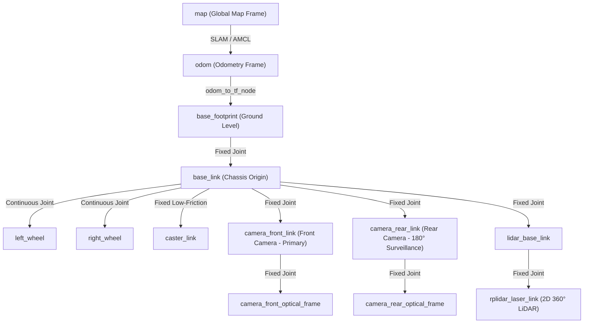
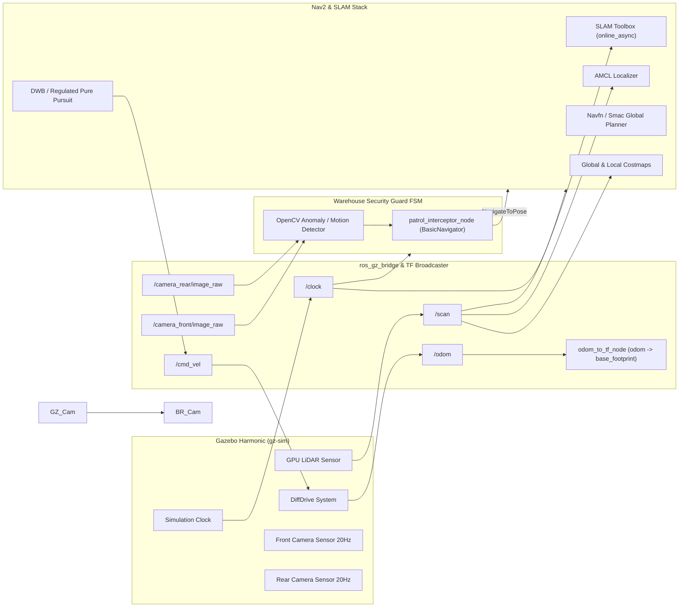
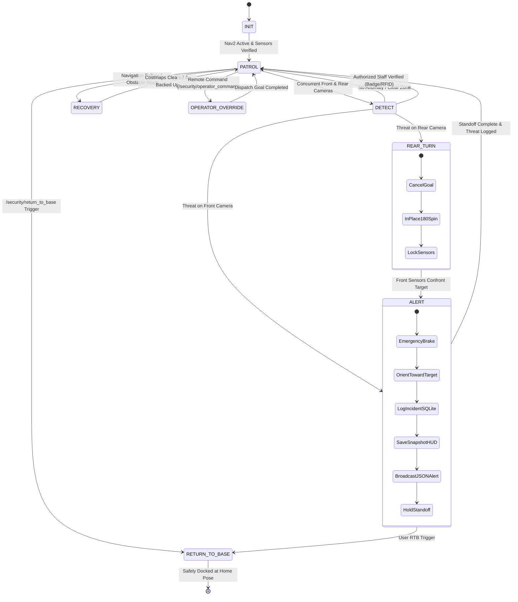

# Autonomous Warehouse Security AMR (ROS 2 Jazzy & Gazebo Harmonic)

[](https://docs.ros.org/en/jazzy/)
[](https://gazebosim.org/docs/harmonic)
[](https://navigation.ros.org/)
[](https://github.com/SteveMacenski/slam_toolbox)
[](https://opencv.org/)

**[🇮🇷 راهنمای جامع فارسی (Persian Documentation)](./README_FA.md)** | **[🇬🇧 English Documentation](./README.md)**

An enterprise-ready **Autonomous Mobile Robot (AMR)** engineered for **Warehouse & Industrial Workshop Surveillance**, perimeter security patrols, real-time threat interception, and automated facility monitoring. Built natively on **ROS 2 Jazzy** and simulated in **Gazebo Harmonic (gz-sim 8)** with full hardware-accurate kinematic models, sensor bridges, Nav2 autonomous navigation, SLAM Toolbox, and an OpenCV-driven Finite State Machine (FSM).

---

## ⚡ Quick Start & Installation (For New Users)

Anyone who clones this repository can build and run it out of the box with standard ROS 2 Jazzy:

### 1. Clone the Repository
```bash
cd ~
git clone https://github.com/mamadixm/autonomous-warehouse-security-amr.git amr_project_ws
cd ~/amr_project_ws
```

### 2. Install Dependencies
```bash
sudo apt update
sudo apt install -y \
    ros-jazzy-navigation2 \
    ros-jazzy-nav2-bringup \
    ros-jazzy-nav2-simple-commander \
    ros-jazzy-slam-toolbox \
    ros-jazzy-ros-gz \
    ros-jazzy-ros-gz-sim \
    ros-jazzy-ros-gz-bridge \
    ros-jazzy-cv-bridge \
    ros-jazzy-teleop-twist-keyboard \
    python3-pip python3-opencv

pip install --break-system-packages fastapi uvicorn websockets pillow
```

### 3. Build Workspace
```bash
source /opt/ros/jazzy/setup.bash
colcon build --symlink-install
```

### 4. Single-Command Launch (Autonomous End-to-End Demo)
```bash
source /opt/ros/jazzy/setup.bash
source ~/amr_project_ws/install/setup.bash

# Run in low-resource headless mode (no GPU overload):
ros2 launch amr_command_center full_demo.launch.py headless:=true rviz:=false
```
Open your browser to: **`http://localhost:8080`**

---

## 🏛️ System Architecture

### 1. Transform (TF) Tree Architecture
A continuous, single-rooted kinematic tree maintaining strict timestamp synchronization between Gazebo Harmonic simulation time and ROS 2:



---

### 2. Software Architecture & ROS 2 Dataflow



---

### 3. Security Guard Finite State Machine (FSM)

The security patrol supervisor utilizes `nav2_simple_commander` (`BasicNavigator`) to orchestrate multi-waypoint perimeter patrols while concurrently streaming and processing computer vision frames:



---

## 📦 Packages in this Workspace

| Package | Role & Description |
| :--- | :--- |
| **`amr_description`** | Custom robot definition and Gazebo Harmonic system plugin bindings (`gz-sim-diff-drive`, `gz-sim-sensors`, `gz-sim-joint-state-publisher`). |
| **`andino_description`** | Official high-fidelity 3D STL meshes, physical inertia models, and macro definitions. |
| **`amr_gazebo`** | Warehouse depot simulation world (`worlds/depot.sdf`), ROS-GZ parameter bridges (`config/bridge.yaml`), and anomaly test injection scripts. |
| **`amr_navigation`** | Core autonomy stack: `odom_to_tf`, `slam_toolbox` mapping configurations, `nav2_params.yaml`, and the `patrol_interceptor` FSM node. |
| **`amr_command_center`** | High-performance FastAPI, WebSocket, and Dual-MJPEG Video Streaming backend server. |
| **`nav2_bringup`** | Local Nav2 bringup launcher and lifecycled navigation pipelines. |
| **`nav2_simple_commander`** | High-level Python application commander interface for Nav2 autonomy. |

---

## 🚀 Execution Guide

### 🌟 Single-Command End-to-End Autonomous Demo (Recommended)
Execute the complete mission lifecycle automatically from start to finish with a **single command**:
```bash
source /opt/ros/jazzy/setup.bash
source ~/amr_project_ws/install/setup.bash
ros2 launch amr_command_center full_demo.launch.py
```
> **Tip (Low-Resource / Headless Mode):** To save GPU/CPU and run smoothly without opening heavy GUI windows, simply append `headless:=true rviz:=false`:
> ```bash
> ros2 launch amr_command_center full_demo.launch.py headless:=true rviz:=false
> ```
> Monitor the entire mission via the lightweight Tactical Web UI at **`http://localhost:8080`**.

---

### Prerequisites & Workspace Build
Source your ROS 2 Jazzy underlay and compile the workspace:

```bash
source /opt/ros/jazzy/setup.bash
cd ~/amr_project_ws
colcon build --symlink-install
source install/setup.bash
```

---

### Modular Multi-Terminal Execution Guide

### Phase 1: Warehouse Mapping (SLAM)
Construct a high-resolution 2D occupancy grid map of the warehouse environment:

#### Option A: 100% Autonomous Frontier Exploration & Return to Base (Recommended)
Launch SLAM, Nav2, and the Autonomous Frontier Explorer node together. The robot will detect frontiers, plan global collision-free paths using Nav2, systematically map every unexplored sector without repeating already-visited areas, automatically save the map upon completion, and return to home base `(0, 0, 0)`:

1. **Terminal 1: Start Gazebo Harmonic Simulation**
   ```bash
   source /opt/ros/jazzy/setup.bash
   source ~/amr_project_ws/install/setup.bash
   ros2 launch amr_gazebo warehouse.launch.py
   # Note: 'sim.launch.py' is also supported as an equivalent alias
   ```

2. **Terminal 2: Launch SLAM + Nav2 Frontier Exploration**
   ```bash
   source /opt/ros/jazzy/setup.bash
   source ~/amr_project_ws/install/setup.bash
   ros2 launch amr_navigation auto_mapping.launch.py
   ```
   *The robot will initialize, seed the map with an initial spin, systematically explore all frontiers, automatically save `warehouse_map`, and return to base `(0.0, 0.0, 0.0)`.*
   *(Optional: You can pause/resume exploration anytime with `ros2 service call /explore/enable std_srvs/srv/SetBool "{data: false}"`)*

#### Option B: Manual Mapping with Teleoperation
If you prefer manual steering:
1. **Terminal 1:** `ros2 launch amr_gazebo sim.launch.py`
2. **Terminal 2:** `ros2 launch amr_navigation slam.launch.py`
3. **Terminal 3:** `ros2 run teleop_twist_keyboard teleop_twist_keyboard`
4. **Terminal 4:** `ros2 run nav2_map_server map_saver_cli -f ~/amr_project_ws/src/amr_navigation/maps/warehouse_map`

---

### Phase 2: Autonomous Patrol & Intruder Interception

### Phase 2: Autonomous Security Patrol & Web Command Center

You can launch the complete autonomous security stack and web command center with either **one unified command** (recommended) or individually:

#### Option A: Unified Tactical Launch (Recommended)
1. **Terminal 1: Start Simulation in Depot World**
   ```bash
   source /opt/ros/jazzy/setup.bash
   source ~/amr_project_ws/install/setup.bash
   ros2 launch amr_gazebo warehouse.launch.py
   # Note: 'sim.launch.py' is also supported as an equivalent alias
   ```

2. **Terminal 2: Launch Unified Security & Web Command Center**
   ```bash
   source /opt/ros/jazzy/setup.bash
   source ~/amr_project_ws/install/setup.bash
   ros2 launch amr_command_center security_command_center.launch.py
   ```
   *This starts Nav2 navigation, the 360° Patrol Guard FSM, SQLite blackbox logging, and the FastAPI/WebSocket server on `http://localhost:8080` in one clean command.*

3. **Terminal 3: Live Operations & Anomaly Testing**
   Open your browser to **`http://localhost:8080`** to access the live dashboard:
   - **Front & Rear 360° Surveillance Video Feeds** (`/stream/front` and `/stream/rear`)
   - **Interactive Map Canvas**: Live robot tracking, obstacle floorplan, and click-to-navigate
   - **On-Screen Teleop & Keyboard (WASD) Overrides**
   - **Forensic Incident History & Snapshot Log**

   Inject threats and authorized staff from the terminal to test live detection:
   - **Test 1: Spawn Unauthorized Intruder Ahead (Red Cylinder):**
     ```bash
     ~/amr_project_ws/src/amr_gazebo/scripts/spawn_intruder.sh 1.5 0.0 0.35
     ```
     *The AMR detects the threat, stops, aligns bearing, logs the incident to `data/security_incidents.db`, saves a snapshot, and flashes the alert card on the Web UI.*

   - **Test 2: Spawn Unauthorized Intruder Behind Robot (Rear Camera 180° Spin Test):**
     ```bash
     ~/amr_project_ws/src/amr_gazebo/scripts/spawn_intruder.sh -1.5 0.0 0.35
     ```
     *Watch the AMR detect the threat on the REAR camera, execute an in-place 180° spin to confront the target with front sensors, and enter ALERT standoff!*

   - **Test 3: Spawn Authorized Security Officer with High-Vis Vest & RFID Badge:**
     ```bash
     ~/amr_project_ws/src/amr_gazebo/scripts/spawn_guard.sh 1.5 0.0 0.35
     ```
     *The AMR identifies the green vest and simulated RFID beacon (`SEC-042`), recognizes the person as `AUTHORIZED_SECURITY`, logs a friendly greeting, and continues patrol.*

   - **Clean Up Spawned Targets:**
     ```bash
     ~/amr_project_ws/src/amr_gazebo/scripts/spawn_intruder.sh delete
     ~/amr_project_ws/src/amr_gazebo/scripts/spawn_guard.sh delete
     ```

#### Option B: Modular Multi-Terminal Launch
If debugging individual subsystems:
1. **Simulation:** `ros2 launch amr_gazebo warehouse.launch.py`
2. **Nav2:** `ros2 launch amr_navigation navigation.launch.py`
3. **Guard FSM:** `ros2 launch amr_navigation guard.launch.py`
4. **Command Center Backend:** `ros2 launch amr_command_center command_center.launch.py`

---

## ⚙️ Configuration & Customization

- **Patrol Waypoints:** Edit [`src/amr_navigation/config/patrol_waypoints.yaml`](src/amr_navigation/config/patrol_waypoints.yaml) to modify waypoint coordinates `[x, y, yaw]`, base station home pose, or computer vision thresholds.
- **Nav2 Tuning:** Modify [`src/amr_navigation/config/nav2_params.yaml`](src/amr_navigation/config/nav2_params.yaml) to customize footprint inflation, DWB velocity limits, or AMCL beam parameters.
- **Gazebo World:** Adjust warehouse layout or add storage racks in [`src/amr_gazebo/worlds/depot.sdf`](src/amr_gazebo/worlds/depot.sdf).
